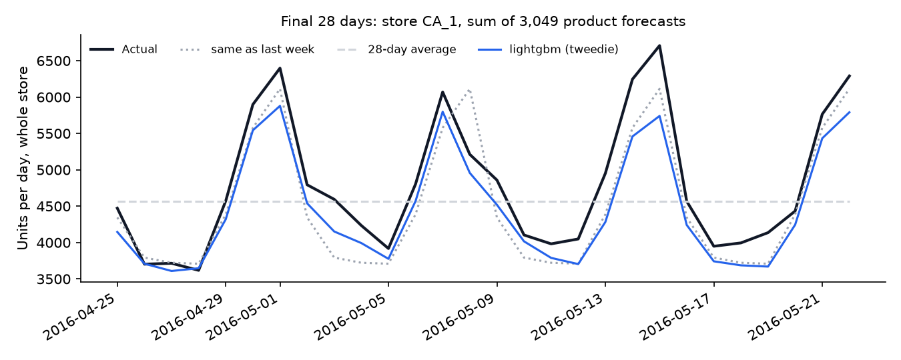
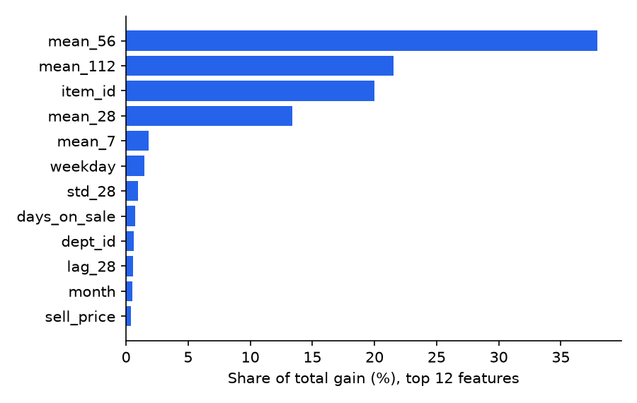

# Retail Demand Forecasting


Daily sales forecasts for every product in a Walmart store, 28 days ahead, using the [M5 competition](https://www.kaggle.com/competitions/m5-forecasting-accuracy) data. One LightGBM model covers all 3,049 products. It is compared against simple baselines in a backtest over three earlier periods, then evaluated once on the final 28 days.

## Data

M5 covers Walmart sales from 2011 to 2016: daily units per product and store, weekly prices, and a calendar with holidays, sporting and cultural events, and SNAP days (US food-stamp payouts).

This project uses one store, **CA_1**:
- **3,049 products** in 7 departments (food, household, hobbies), from January 2014 onwards;
- **2.6 million product-days**;
- **56 % of product-days have zero sales.** Most products sell irregularly.

| Demand pattern (last year) | Products |
|---|---:|
| Smooth: sells almost every day, steady amounts | 356 |
| Erratic: sells almost every day, amounts vary a lot | 67 |
| Intermittent: many days without a sale | 2,232 |
| Lumpy: many days without a sale, and amounts vary a lot | 388 |

## Results

Final 28 days, 25 April to 22 May 2016, forecast once:

| | Product-level error (WAPE) | Scaled error (RMSSE) | Store-total error (WAPE) | Bias |
|---|---:|---:|---:|---:|
| Same as last week | 86.8 % | 1.003 | 7.2 % | −5.6 % |
| 28-day average | 74.8 % | 0.783 | 15.1 % | −4.5 % |
| **LightGBM (tweedie loss)** | **72.8 %** | **0.768** | **6.8 %** | −6.8 % |

**Metrics:**
- **WAPE** is total absolute error divided by total units sold.
- **RMSSE** is the M5 competition's error per product, scaled by how much that product's sales normally change from day to day, then averaged.
- **Store-total error** compares the sum of all product forecasts with the store's actual daily sales.



**What the numbers show:**
- **At product level, the model is only slightly better than a 28-day average.** Most products sell 0, 1 or 2 units on a given day, and which of these happens is largely random. A product-level WAPE above 70 % is normal for this kind of data. For the 356 smooth products, WAPE is 47 %; for the 2,232 intermittent ones it's 90 %.
- **For the store total, the model is clearly better.** It halves the error of the 28-day average because it knows the weekly pattern, and it beats "same as last week" too. Totals are what drive staffing and replenishment.
- **The forecast is about as good four weeks out as one week out** (WAPE 71 % in week 1, 75 % in week 4). That's by design: the model only uses sales from at least 28 days before the day it predicts.

## Backtest: choosing the model

Three earlier 28-day periods, each forecast with a model trained only on data before it. Averages:

| | WAPE | RMSSE | Bias |
|---|---:|---:|---:|
| **LightGBM, tweedie loss** | **74.3 %** | **0.710** | −1.4 % |
| LightGBM, poisson loss | 74.6 % | 0.710 | −0.8 % |
| 28-day average | 74.8 % | 0.713 | −2.6 % |
| LightGBM, squared error | 75.3 % | 0.717 | 0.1 % |
| Same as last week | 87.7 % | 0.925 | −4.4 % |

Tweedie and poisson losses suit sales counts with many zeros, and both beat squared error. Tweedie had the lowest average error, so it was used for the final forecast.

## Error analysis (final 28 days)

| | WAPE | Bias |
|---|---:|---:|
| FOODS_3 (largest department, 49 % of units) | 59 % | −11 % |
| HOUSEHOLD_1 | 75 % | +3 % |
| HOBBIES_1 | 93 % | −3 % |
| Smooth products | 47 % | +2 % |
| Intermittent products | 90 % | −11 % |
| Event days | 69 % | −6 % |

All breakdowns are in [`results/breakdown.csv`](results/breakdown.csv).

**Main weakness: the model under-forecast the final period by 7 %**, mostly on weekend peaks and food. In the backtest the bias was only −1.4 %, so the final window had more demand than the earlier periods suggested.

I didn't tune the model further after seeing this. Changing it based on the test result would make the test result meaningless. The next steps would be checked on new backtest windows:
- a trend feature (recent vs longer-term average);
- a recursive model that uses the last week of sales for the first days of the forecast.



The model relies mostly on each product's average sales over the previous 2–4 months, the product itself, and the weekday.

## How the model works

- **Direct 28-day forecast.** Every sales feature uses sales from at least 28 days before the forecast day: lags on the same weekday, rolling averages, variability, and the share of days without a sale. One model can then forecast all 28 days without feeding its own forecasts back in. A test checks that changing the last 27 days of sales doesn't change any feature.
- **Known-in-advance features.** Price, price changes, price relative to the department, weekday, month, events and SNAP days are planned ahead, so they are used for the forecast day itself.
- **Products not yet on sale are dropped.** A product with no price on a day wasn't on the shelf, so its zeros aren't demand.

## Running it

```bash
python -m venv .venv
.venv\Scripts\activate             # source .venv/bin/activate on Mac/Linux
pip install -r requirements.txt

python forecast.py                 # downloads the data (50 MB), backtest + final forecast, several minutes
pytest                             # 13 tests, no data needed
```

## Project structure

```
data.py          download M5, build the store's daily product table
features.py      lags, rolling statistics, price and calendar features (all at least 28 days old)
evaluation.py    baselines, WAPE / RMSSE / bias, demand-pattern classes
forecast.py      backtest, model choice, final forecast, error breakdown, charts
results/         backtest.csv, breakdown.csv, results.json
docs/            charts
tests/           leakage check, features, baselines, metrics
```

## Limitations

- **One store.** M5 has ten stores and a hierarchy of states, categories and departments. Forecasting across stores, and making product, department and store forecasts add up, is out of scope.
- **Point forecasts only.** Replenishment needs ranges (for example the 90th percentile for safety stock), which LightGBM can give with a quantile loss.
- **Fixed hyperparameters.** Only the loss function was selected; tree settings were fixed.
